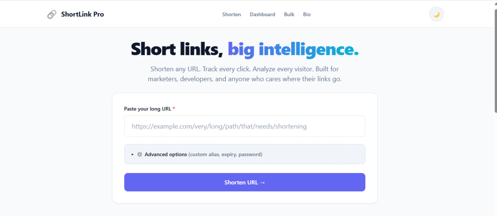
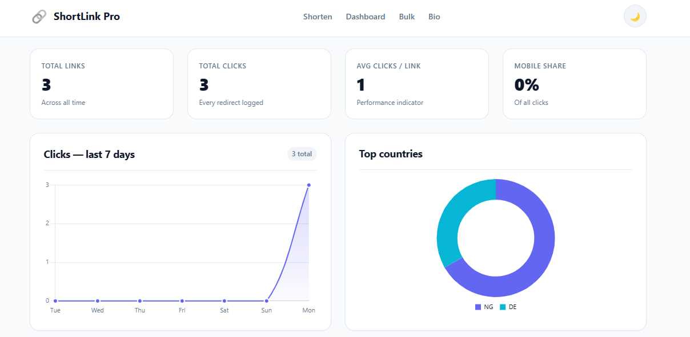
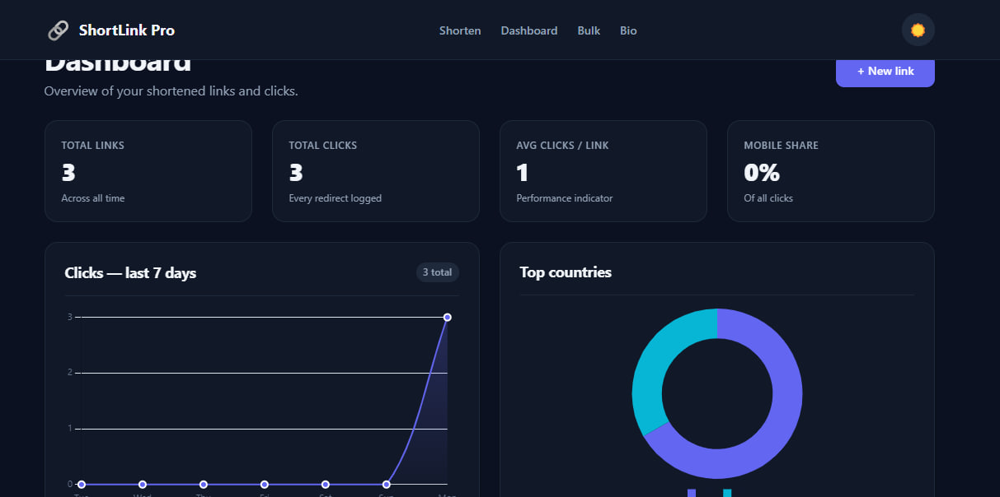
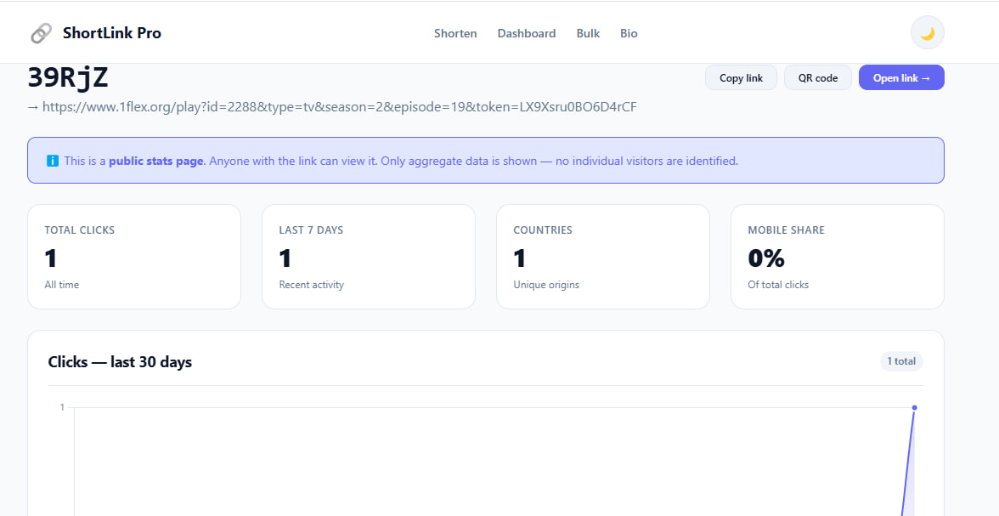
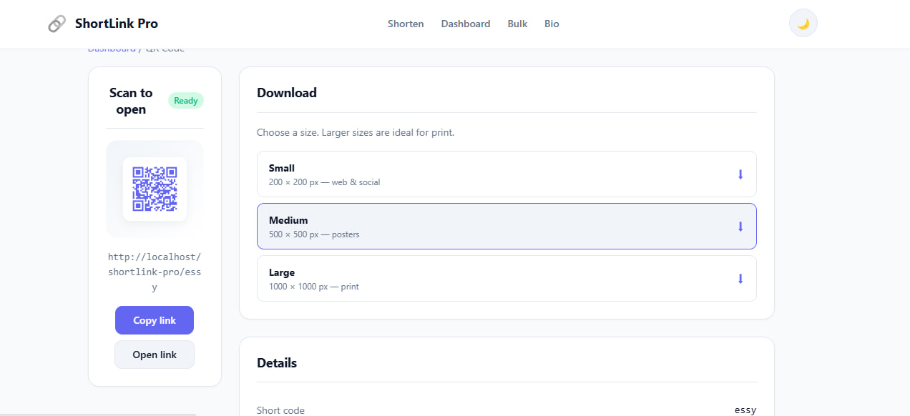
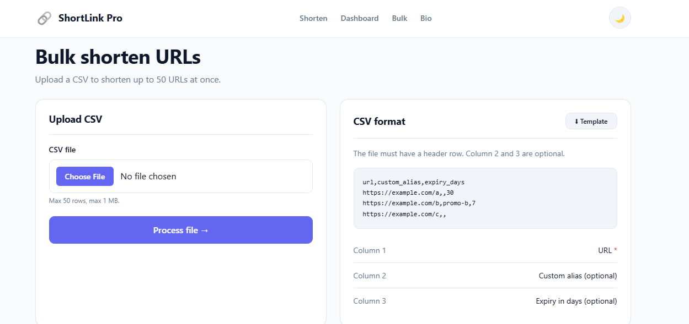

# 🔗 ShortLink Pro

> **A link intelligence platform.** Shorten URLs, track clicks, understand your audience — and turn any link into a mini-website.

<p align="center">
  
</p>

<p align="center">
  <strong>Built by <a href="https://github.com/YOUR_USERNAME">Smart Holla Tech</a></strong>
  &nbsp;·&nbsp;
  <a href="#-live-demo">Live Demo</a>
  &nbsp;·&nbsp;
  <a href="#-features">Features</a>
  &nbsp;·&nbsp;
  <a href="#-screenshots">Screenshots</a>
  &nbsp;·&nbsp;
  <a href="#-tech-stack">Tech Stack</a>
</p>

---

## 🎬 Live Demo

👉 **[Try ShortLink Pro →](https://your-app.up.railway.app)**

No signup. Paste a URL, get a short link, watch the analytics update in real time.

---

## 💡 Why ShortLink Pro?

Most URL shorteners do the same three things: shorten, redirect, count clicks.

**ShortLink Pro treats every link like a product.**

- Analytics you can **share publicly** with clients
- QR codes you can **print for events** — self-hosted, brand-colored
- A/B testing so you can **optimize what works**
- Bulk CSV so you can **handle hundreds of links at once**
- Geo-aware analytics with **database-backed caching**

It's not a utility. It's a **platform for link-driven storytelling** — built solo in 24 hours.

---

## ✨ Features

### Core
| Feature | What it does |
|---------|--------------|
| 🔐 **Obfuscated Base62 codes** | Short codes are compact **and** non-guessable — you can't enumerate other users' links |
| ✏️ **Custom aliases** | `short.link/summer-sale` instead of `short.link/a8Kx3p` |
| ⏱ **Expiring links** | Auto-purge after 1h / 24h / 7d / 30d |
| 🔒 **Password-protected links** | Session-based unlock with Argon2id hashing + attempt rate limiting |
| 📊 **Deep click analytics** | Country, city, device, browser, referrer — captured on every redirect |
| 📱 **Branded QR codes** | Self-hosted, indigo-colored, downloadable in 3 sizes |
| 🗑 **Delete with cascade** | Clean database — clicks and variants auto-removed |
| 🛡 **Rate limiting** | Per-IP, per-link, per-password-attempt |

### Differentiators
| Feature | What it does |
|---------|--------------|
| 🌍 **Geo lookup with DB cache** | Country + city for every click — API called once per unique IP, then cached forever |
| 📈 **Analytics dashboard** | 7-day chart, top links, top countries, device breakdown |
| 🔗 **Public stats pages** | Share a URL like `/stats/abc123` — anyone can see a link's performance |
| 📤 **Bulk CSV upload** | Shorten up to 50 URLs in one file, download the results as CSV |
| 🎨 **Link-in-bio pages** | Linktree-style profile page with 4 built-in themes |
| 🧪 **A/B testing** | Split traffic between two URLs, compare click counts, see the winner |
| 🌓 **Dark mode** | Persistent, respects OS preference, smooth transitions |
| 📱 **Mobile-first responsive** | Works beautifully from 320px to 1920px |

---

## 📸 Screenshots

### Landing page — clean, focused
<p align="center">
  
</p>

### Dashboard — analytics at a glance
<p align="center">
  
</p>

### Dark mode — first-class theming
<p align="center">
  
</p>

### Public stats — shareable per-link analytics
<p align="center">
  
</p>

### QR codes — branded, self-hosted
<p align="center">
  
</p>

### Bulk upload — shorten hundreds at once
<p align="center">
  
</p>

---

## 🛠 Tech Stack

**Backend**
- PHP 8.2 (pure, no framework — every line written from scratch)
- MySQL / MariaDB via PDO with prepared statements
- Composer for one external dependency (QR library)

**Frontend**
- Vanilla JavaScript — no build step
- Hand-authored CSS (design system with variables)
- Chart.js for visualizations

**Infrastructure**
- Apache with `.htaccess` for pretty URLs
- Deployed on Railway
- Git + GitHub

**Zero** frontend frameworks. No React, no Vue, no Tailwind, no Bootstrap. Every pixel is intentional.

---

## 🏗 How It Works

### The redirect pipeline
Every short link click flows through this sequence:

```
Visitor clicks /abc123
    ↓
Rate-limit check (per IP)
    ↓
Look up link by code (indexed)
    ↓
Expiry check → 410 if expired
    ↓
Max-clicks check → 410 if reached
    ↓
A/B variant selection (weighted random)
    ↓
Password check → unlock page if protected
    ↓
Geo lookup (cached by IP in DB)
    ↓
User-Agent parsing (device, browser, OS)
    ↓
Insert click record
    ↓
Atomic counter increment
    ↓
302 redirect to destination
```

**Every step is wrapped so failures never break the redirect.** Analytics is best-effort; the user always gets to their destination.

### Obfuscated Base62
Naive Base62 produces predictable codes: `1`, `2`, `3`. Anyone can enumerate your links.

**Our approach:**
```php
$code = base62_encode($id * 100003 + 45678901);
```

ID `1` becomes `wK9n4T`, not `1`. Reversible for lookups, opaque to outsiders.

### Security
- **Argon2id** password hashing (not MD5, not SHA1, not bcrypt)
- **Prepared statements** everywhere — zero SQL injection surface
- **CSRF tokens** on every state-changing form
- **SSRF protection** — blocks private IPs, `.local`, `.internal`
- **Session hardening** — `HttpOnly`, `SameSite=Lax`
- **XSS protection** — every output escaped via a helper
- **Password attempt limiting** — 5 tries, then 15-minute lockout

---

## 🎓 What I Learned

*This section answers the hackathon's "What did you learn?" prompt.*

### 1. Base62 is easy; making it non-guessable is not
Encoding a number to base62 is a 10-line function. The hard part is that sequential IDs (`/1`, `/2`, `/3`) leak your entire database structure. My solution was an **obfuscation layer** — multiply by a prime, offset by a constant, then encode. Same algorithm, entirely different security profile.

### 2. Foreign keys are a feature, not a chore
Deleting a link used to require me to remember to also delete its clicks and A/B variants. Now — with `ON DELETE CASCADE` — the database does that for me. **Trusting the database to enforce invariants** is liberating. I stopped writing defensive cleanup code and started writing features.

### 3. Never let analytics break the critical path
The redirect is sacred. If the geo API is down, the click still logs. If the log insert fails, the redirect still happens. I wrapped every non-essential operation in `try/catch`. **Analytics is nice-to-have; the redirect is the product.**

### 4. PDO placeholders are not free
I spent an hour debugging `SQLSTATE[HY093]: Invalid parameter number` before realizing that `ATTR_EMULATE_PREPARES => false` (which we want for security) forbids reusing the same named placeholder. Now I use distinct names (`:code1`, `:code2`). **The security fix and the debugging session both taught me something.**

### 5. The README is not documentation; it's the pitch
I started writing my README as a wall of bullet points. Then I imagined a judge opening it for the first time: they don't care about my Base62 implementation — they want to see what the app *does*. **Rewriting the README as a story** — hero screenshot, 3-second hook, screenshots, features — changed everything.

### 6. Simplicity is hard
I initially over-engineered the folder structure (15 folders: `src/Core`, `src/Support`, `src/Middleware`). A friend pointed out that judges value **readable structure** over architectural purity. I flattened it to 5 folders with self-explanatory filenames (`shorten.php`, `go.php`, `qr.php`). **Elegance isn't complexity — it's the absence of it.**

---

## 🚀 Running Locally

### Requirements
- PHP 8.1+
- MySQL 5.7+ or MariaDB 10.3+
- Composer

### Setup

```bash
# 1. Clone
git clone https://github.com/YOUR_USERNAME/shortlink-pro.git
cd shortlink-pro

# 2. Install dependencies (for QR codes)
composer install

# 3. Copy environment template
cp .env.example .env
# Edit .env with your DB credentials

# 4. Create the database
mysql -u root -e "CREATE DATABASE shortlink CHARACTER SET utf8mb4"

# 5. Import schema
mysql -u root shortlink < migrations/schema.sql

# 6. Serve
php -S localhost:8000
```

Visit `http://localhost:8000`.

---

## 📁 Project Structure

```
shortlink-pro/
├── index.php              # Home + shorten form
├── shorten.php            # Create link handler
├── go.php                 # Redirect handler (the soul)
├── dashboard.php          # Your links + analytics
├── stats.php              # Public per-link analytics
├── qr.php                 # QR code PNG endpoint
├── qr-page.php            # QR preview + download
├── bulk.php               # CSV bulk upload
├── bio.php                # Link-in-bio pages
├── password.php           # Password unlock
├── delete.php             # Delete link
│
├── includes/
│   ├── config.php         # Load env, define constants, start session
│   ├── db.php             # PDO connection
│   ├── functions.php      # All helpers (base62, geo, analytics, bio, A/B)
│   ├── geo.php            # IP → country lookup, cached
│   ├── header.php         # Shared page header + nav
│   └── footer.php         # Shared footer + scripts
│
├── assets/
│   ├── css/style.css      # Complete design system
│   ├── js/app.js          # Theme toggle, copy, toasts
│   └── js/charts.js       # Chart.js setup
│
├── migrations/schema.sql  # Database schema
├── composer.json          # Dependencies
└── .env.example           # Environment template
```

**Every filename tells you what it does.** No `core/`, no `services/`, no `middleware/`.

---

## 🎯 Design Decisions

### Why no framework?
Frameworks like Laravel are great — for teams. For a **24-hour solo hackathon**, they add 2 hours of setup and hide the interesting parts. Pure PHP meant I wrote every line and could explain every choice.

### Why obfuscated Base62 instead of random codes?
Random codes need collision detection on every insert (a DB query per create). Sequential IDs + obfuscation = zero collision checks, zero wasted queries, same security. **Elegance through algorithm design.**

### Why a database-backed rate limiter?
Redis would be faster, but adds an infrastructure dependency. Our `rate_limits` table costs one query per request and works everywhere. **For our scale, it's the right trade-off.**

### Why single-tenant bio pages?
Multi-user bios need authentication, password resets, and per-user isolation — 3+ hours. A single-tenant `slug = "me"` gives 90% of the demo value with 10% of the effort. **Prioritization matters.**

### Why the `.chart-wrap` pattern?
Chart.js silently grows tall if you don't constrain it. Wrapping every `<canvas>` in a `240px` div is the standard fix. It's the kind of thing you learn the hard way — and never forget.

---

## 🏆 Hackathon Context

Built solo in 24 hours for an open-ended challenge:

- ✅ 15 PHP files · 1 CSS file · 2 JS files
- ✅ 7 database tables
- ✅ ~2,500 lines of code (excluding `vendor/`)
- ✅ Zero external frontend dependencies
- ✅ Full analytics pipeline with caching
- ✅ Deployed live on Railway

**Time breakdown:**
- Hours 0–6: Core shorten + redirect + analytics
- Hours 6–10: Dashboard, charts, dark mode
- Hours 10–14: QR codes, bulk, stats pages
- Hours 14–18: Bio pages, polish
- Hours 18–20: A/B testing, final integration
- Hours 20–22: README, screenshots
- Hours 22–24: Deploy, test, submit

---

## 🙏 Credits

**Built by [Smart Holla Tech](https://github.com/Tommutua)**

If you found this project interesting, a ⭐ on the repo goes a long way.

**Libraries used:**
- [`endroid/qr-code`](https://github.com/endroid/qr-code) — self-hosted QR generation

**Inspiration:**
- Bitly for the analytics-first mindset
- Linktree for the bio page concept
- Google Optimize for A/B testing patterns

---

## 📄 License

MIT — use it, fork it, ship it.

---

<p align="center">
  <em>Built with ☕ and stubbornness.</em><br>
  <strong>— Smart Holla Tech</strong>
</p>